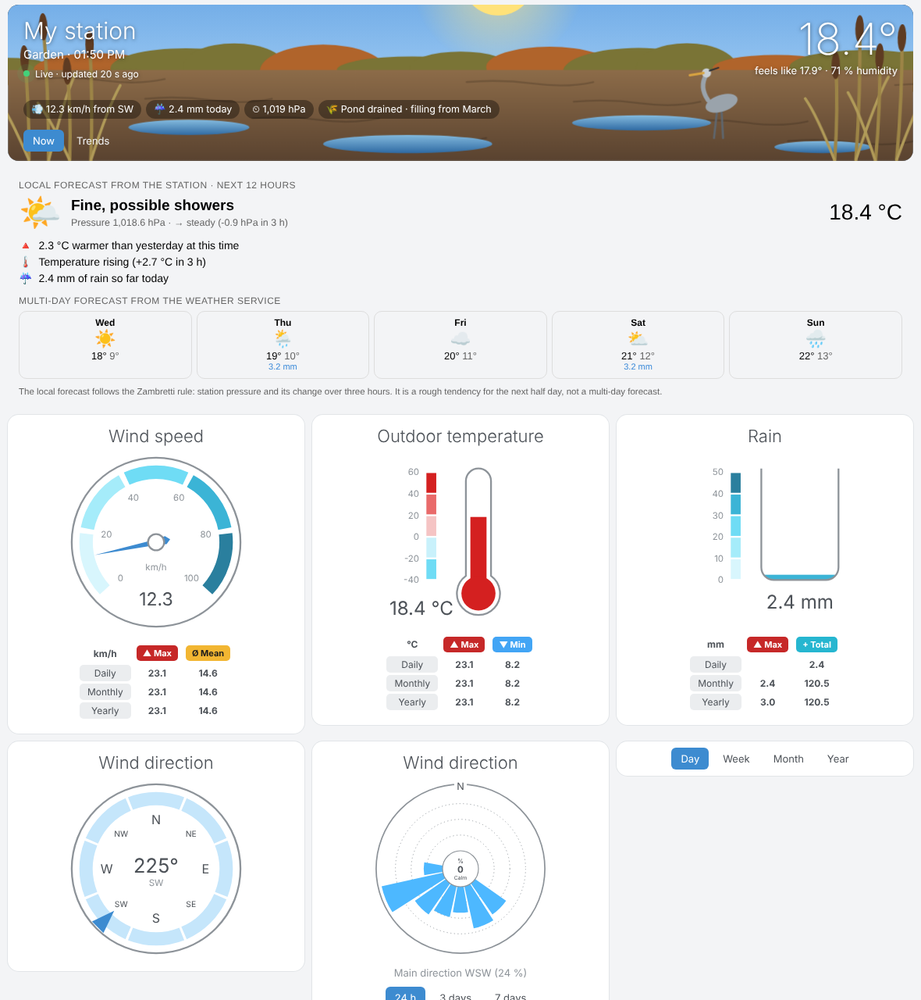

# Weather Station Card

Instruments and history charts for a personal weather station in Home Assistant – Ecowitt, Netatmo, Davis, or any sensors you have.
Two cards in one file:

- **`weather-station-card`** – one card, eight variants: an animated `header`, a round `dial`, a `thermo`meter, a `rain` gauge, a wind `compass`, a wind `rose`, a history `chart` and a shared time `range` switch.
- **`zambretti-forecast-card`** – a short-term forecast computed from your own air pressure and its 3-hour trend (Zambretti rule), plus hints such as frost, fog or a fast pressure drop, and optionally the multi-day forecast of a `weather` entity.



Dials and gauges show **daily, monthly and yearly** max / min / mean from Home Assistant's long-term statistics. The header follows the sun (day, dusk, night), rain, frost and the seasons. UI texts are available in **English and German** and follow the user's language.

## Installation

**HACS** (recommended): HACS → ⋮ → *Custom repositories* → add this repository's URL with type *Dashboard* → install *Weather Station Card* → reload the browser.

**Manual:** copy `weather-station-card.js` to `config/www/` and add it as a dashboard resource (`/local/weather-station-card.js`, type *JavaScript module*).

The sensors need a `state_class` (e.g. `measurement`) so that long-term statistics exist.

## weather-station-card

| Option | Variants | Description |
|---|---|---|
| `variant` | all | `header`, `range`, `dial`, `thermo`, `rain`, `compass`, `rose`, `chart` (required) |
| `entity` | all but `range` | Sensor to show. For `header`: the outdoor temperature |
| `name` | instruments | Title (default: friendly name) |
| `unit`, `decimals` | instruments | Override unit / decimal places |
| `min`, `max`, `ticks`, `colors` | `dial`, `thermo`, `rain` | Scale. `ticks` are numbers or `{v: 3, l: '3'}` |
| `stats` | `dial`, `thermo` | Columns of the table: any of `max`, `min`, `mean` (default `[max, min]`) |
| `stat_entity` | `rain` | Total-rain sensor (`total_increasing`) for monthly / yearly sums (required for `rain`) |
| `speed_entity`, `mode: speed`, `calm` | `rose` | Wind speed for the rose; `mode: speed` shows average speed per direction |
| `mode` | `chart` | `line` (default, min/mean/max), `bar` (sums), `dots` (e.g. wind direction) |
| `series` | `chart` | Custom series: `[{stat: max, label: Gusts, color: '#1f6fb8', entity: sensor.gust}]` |
| `ymin`, `ymax` | `chart` | Fixed y axis |
| `theme` | instruments | `dark` (default follows HA), `light` |
| `title`, `location` | `header` | Big title and small subtitle |
| `feels`, `humidity`, `wind`, `wind_dir`, `rain_today`, `rain_rate`, `pressure` | `header` | Optional sensors for the header line and chips |
| `prefix` | `header` | Entity-ID prefix of the station, used for the *live / last update* indicator |
| `links` | `header` | Tabs in the header: `[{label: Now, path: /weather/now}]` |
| `pond` | `header` | Optional seasonal pond (see below) |

The `range` card switches all `chart` cards on the page between day, week, month and year.

### Seasonal pond (optional)

In some regions fish ponds are filled in spring and drained in autumn. With `pond: true` the header shows the water level over the year, a fishing boat while draining, and a heron on the empty pond bed. Dates can be changed:

```yaml
pond:
  fill_start: '03-01'   # filling starts
  full: '04-15'         # pond is full
  drain: '10-25'        # draining starts
  empty: '11-01'        # pond is empty
```

### Example

```yaml
type: custom:weather-station-card
variant: header
title: My station
location: Garden
entity: sensor.station_outdoor_temperature
feels: sensor.station_feels_like_temperature
humidity: sensor.station_humidity
wind: sensor.station_wind_speed
wind_dir: sensor.station_wind_direction
rain_today: sensor.station_daily_rain
rain_rate: sensor.station_rain_rate
pressure: sensor.station_relative_pressure
```

```yaml
type: custom:weather-station-card
variant: dial
entity: sensor.station_uv_index
name: UV index
max: 12
decimals: 0
unit: ''
ticks: [{v: 0, l: '0'}, {v: 3, l: '3'}, {v: 6, l: '6'}, {v: 8, l: '8'}, {v: 11, l: '11+'}]
colors: ['#7ac70c', '#a8d51a', '#f5e663', '#f5b942', '#f08a24', '#e0362c', '#b02a7c', '#7c3aed']
stats: [max]
```

```yaml
type: custom:weather-station-card
variant: rain
entity: sensor.station_daily_rain
stat_entity: sensor.station_total_rain
max: 50
```

```yaml
type: custom:weather-station-card
variant: chart
entity: sensor.station_wind_speed
name: Wind
series:
  - {stat: mean, label: Average, color: '#7cc4fa'}
  - {entity: sensor.station_wind_gust, stat: max, label: Gusts, color: '#1f6fb8'}
```

## zambretti-forecast-card

| Option | Description |
|---|---|
| `pressure` | Relative (sea-level) pressure in hPa (required) |
| `temp`, `dewpoint`, `wind`, `gust`, `rain_rate`, `rain_today` | Optional sensors for the hints |
| `weather` | Optional `weather` entity for a multi-day forecast row |
| `compact` | Small version: forecast line and two hints |
| `navigation_path` | In compact mode, tap opens this path |
| `title`, `show_note` | Custom title; `show_note: false` hides the explanation |

The trend needs about three hours of pressure statistics after the first install.

## Deutsch

Wetterstations-Instrumente und Verlaufsgrafiken für Home Assistant: Kopfbereich mit Tageszeit, Wetter und Jahreszeit, Rundinstrumente mit Tages-, Monats- und Jahreswerten, Thermometer, Regenmesser, Windkompass, Windrose, Diagramme und eine eigene Kurzfrist-Prognose nach der Zambretti-Regel. Die Texte erscheinen automatisch auf Deutsch, wenn Home Assistant auf Deutsch eingestellt ist. Installation über HACS als *benutzerdefiniertes Repository* (Typ *Dashboard*).

## License

MIT – see [LICENSE](LICENSE).
